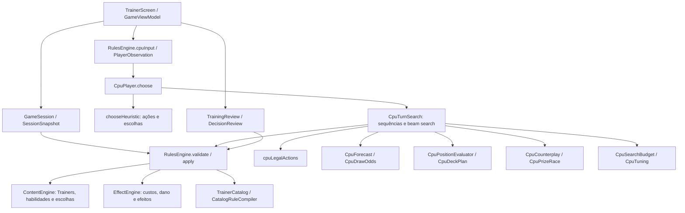

# Auditoria inicial da CPU competitiva

Data: 2026-11-02. Escopo: estrutura atual de `trainer-engine` e integração Android em `trainer-ui`, incluindo alterações locais ainda não commitadas. Esta é uma análise de código; não certifica todos os efeitos do catálogo nem implementa as seis fases propostas.

## Dependências existentes

Todos os nomes abaixo correspondem a código existente. Manter o motor como autoridade de legalidade e resolução; não reimplementar regras na IA.

## Estado, regras e persistência

| Área | Implementação existente | Decisão de arquitetura |
|---|---|---|
| Estado completo | `Model.kt`: `GameState`, `PlayerState`, `PokemonInstance`, `TurnFlags`, `Resolution`, `ChoiceRequest` | Reutilizar os estados serializáveis e transições com `copy`; não criar outro GameState concorrente. |
| Zonas | `PlayerState`: mão, deck ordenado, descarte, prêmios, Ativo e Banco | O estado completo fica no controlador. A IA recebe apenas sua observação autorizada. |
| Efeitos e restrições | Pokémon, flags e estado armazenam ferramentas, condições, custos, bloqueios, bônus, turnos de validade e efeitos pendentes | Incluir esses campos na identidade de estados de busca; nunca deduplicar apenas por HP e energia. |
| Regras | `RulesEngine.validate`, `apply`, `availableAttacks`, `attackCost`, `effectiveAbilities`, `effectiveHp`, `retreatCost`, `benchCapacity` | Simulações devem executar `apply` e validar o resultado. |
| Turnos e resoluções | `actingPlayer`, `nextTurn`, `settle`, filas de promoção e prêmios | Ações de uma escolha podem pertencer ao outro jogador. Profundidade de turno não é contagem de ações. |
| Trainers e habilidades | `ContentEngine.validate`, `apply`, grupos de resolução e `finish` | Usar as mesmas escolhas e efeitos da partida real. |
| Evolução, energia e ataques | `RulesEngine` e `EffectEngine`, com efeitos declarados em `Model.kt` | Não inferir texto de carta dentro da IA. |
| Catálogo | `TrainerCatalog`, `CatalogRuleCompiler`, definições verificadas e biblioteca | Falhas de suporte devem ser limitações explícitas, não efeitos inventados. |
| Save, undo e replay | `GameSession`, `SessionSnapshot`, `dispatch`, `encode`, `decode`, `replay` | Preservar schema e política de undo. Estado da IA pode ser derivado do histórico público ou persistido separadamente. |
| Aleatoriedade | `RngState`, `SeededRng` | RNG da simulação independente do RNG privado real. Seed de debug da IA não dá acesso à seed da partida. |

As estruturas usam `val` e coleções expostas como `List`/`Map`, e o fluxo predominante cria novas cópias. Isso favorece simulações sem alterar o estado original, mas não equivale a uma prova de imutabilidade profunda. Testar conservação do snapshot original e evitar coleções mutáveis compartilhadas.

## Inventário das decisões da CPU

- `RulesEngine.cpuInput`: constrói observação, ações, escolhas permitidas, habilidades efetivas e previsões de ataque.
- `CpuPlayer.choose`: calcula fallback heurístico, detecta certos KOs finais imediatos e aciona busca conforme estratégia.
- `chooseHeuristic`: decide abertura, compras de mulligan, busca/descarte, alvos, evolução, energia, habilidade, Trainer, recuo, promoção, ataque e encerramento. Contém funções locais `keepValue`, `setupValue`, `potential`, `attackValue`, `replyDamage`, `value` e `score`.
- `cpuLegalActions`: gera candidatos para a fase principal e filtra por `validate`. Limita pagamentos de recuo a duas opções; fora da fase principal delega para `legalActions`.
- `CpuTurnSearch`: `search`, `choices`, `prioritizedPreparationGroups`, `trainerPriority`, `diverseBeam`, `attackValue`, `development`, `replyRisk` e `knownReplyPreparations`.
- `CpuCounterplay`: `evaluate`, `publicActions`, `threat`, `postAction`, `nextTurnValue` e `approximate`.
- `CpuPositionEvaluator`: `value` e `features`; avalia atacantes, habilidades de suporte, recuperação, exposição e bloqueios.
- `CpuPrizeRace`: estima turnos necessários para obter prêmios com programação dinâmica sobre alvos visíveis.
- `CpuForecast` e `CpuDrawOdds`: intervalos de dano, composição não observada do próprio deck e cálculo de compra sem reposição; hipóteses de categorias adversárias com listas compatíveis.
- `CpuDeckPlan`: prioridades fixas para os 17 decks e fallback para listas personalizadas.
- `DecisionReview` e `TrainingReview`: já existe análise limitada de decisões humanas e replay; reaproveitar essa integração para a revisão futura.

## Problemas confirmados e riscos a testar

### P0 — Acesso privilegiado incompatível com o novo requisito

`GameViewModel` chama `cpuInput(..., revealOpponentHandToCpu = true)`. A arena faz isso apenas para MASTER. `CpuInput.knownOpponentHand` atravessa a fronteira de observação e `CpuTurnSearch` injeta essas cartas no cenário simulado. Remover essa via, mantendo revelações legítimas exigidas por efeitos.

Os últimos resultados de 40% e 42,5% foram obtidos com essa vantagem. Não podem ser usados como avaliação da futura IA sem trapaça. `docs/CPU-MASTER.md` também contém descrições históricas que já não refletem esse acesso local.

Além disso, auditar histórico, eventos, IDs de cartas, escolhas pendentes e ações geradas antes do mascaramento. Não foi demonstrado nesta análise que esses canais vazem identidades, mas a fronteira precisa de testes adversariais que troquem informação oculta sem mudar a observação.

### P0 — Busca interrompida por informação nova

`knownStep` rejeita mudanças de RNG, novas cartas anônimas na mão e escolhas com cartas anônimas do deck. `publicPosition` pode retornar `null` em buscas que expõem cartas ainda fora do conjunto público. A CPU então resolve por heurística e replaneja depois da revelação, mas não compara antecipadamente a linha inteira que inclui busca, compra e embaralhamento.

Uma busca mais larga, mantendo essa barreira, não resolve o problema. Precisamos de cenários amostrados a partir da informação permitida e nós de chance. O agente simulado também deve decidir com a observação disponível naquele cenário, sem consultar todo o mundo amostrado.

### P1 — Simulação parcial do turno adversário

`CpuCounterplay.publicActions` limita a resposta principalmente a habilidades, recuos, promoções e ataques. `nextTurnValue` limita a preparação seguinte a energia, evolução, Básicos e recuo. Há continuação parcial, não quatro meios-turnos completos com compras e uso geral de Trainers.

`approximate` altera manualmente dano, campo, prêmios e turno. É uma aproximação de avaliação, não uma transição completa das regras: não deve ser reutilizada como simulador de rollouts. Cenários probabilísticos novos precisam passar por `RulesEngine.apply` e resolução real de efeitos, prêmios e promoção.

### P1 — Geração de escolhas e explosão combinatória

O gerador da CPU é seguro por validação, mas não exaustivo: só duas opções de pagamento de recuo. A busca de escolhas usa uma sugestão heurística, escolha vazia e escolhas unitárias limitadas; não explora de forma geral as combinações de descarte, busca e distribuição.

Já `RulesEngine.legalActions` materializa combinações e algumas permutações. Chamá-lo indiscriminadamente em rollouts poderá consumir todo o orçamento. Separar gerador legal preguiçoso de seleção ordenada/bounded para busca, preservando um fallback válido e informando quando a busca foi truncada.

### P1 — Avaliação e corrida de prêmios incompletas

Os pesos do campo são fixos e pequenos diante de bônus de KO; a função de potencial usa principalmente `Effect.Damage` e contagem de energias. Prontidão consulta legalidade, mas não existe um plano explícito com atacante atual, sucessor, reserva e finalizador.

`CpuPrizeRace.frame` coloca fonte e alvo no Ativo e limpa flags para estimar um confronto. Falta cobrar adequadamente acesso ao alvo com gust, mobilidade e perda do atacante entre KOs. A soma dos confrontos não é uma sequência legal executável. Retornar também a rota e suas hipóteses, com custo de acesso e risco.

O reconhecimento de vitória está distribuído entre previews e busca. Transições de preparação que chegam diretamente a `GAME_OVER` são recusadas por `knownStep`, que só aceita `MAIN`/`RESOLVE_CHOICE`. Incluir vitórias por habilidades/efeitos e tratar terminais reais antes de podar a linha.

### P1 — Perfis de deck ainda são prioridades, não estratégias completas

`CpuDeckPlan` contém IDs, bônus de evolução, energia e desenvolvimento. Não implementa planos condicionais completos, gestão do último gust, reserva de evoluções, thinning condicionado ou papéis de ataque por fase. Também não há herança de arquétipos. Esses perfis não comprovam execução de uma estratégia de torneio.

O fallback personalizado consulta `TrainerCatalog` diretamente, em vez do catálogo injetado da CPU. Corrigir esse acoplamento ao extrair perfis extensíveis. Não confundir Pokémon Básicos da linha evolutiva com mecanismos de compra/aceleração apenas porque estão no conjunto chamado `engines`.

### P1 — Orçamento incompleto e configuração dispersa

Há deadline monotônico cooperativo, fallback e modo adaptativo de 200/800/2000 ms. Porém a criação de `cpuInput` ocorre antes do relógio da busca. O fallback e algumas operações grandes não verificam o prazo internamente. O app acrescenta 950 ms entre ações comuns, salva e publica cada estado. Medir tempo de decisão completo e tempo percebido separadamente.

Limites como sete etapas, 260 transições, beam de oito e limites de resposta estão espalhados. Centralizá-los junto aos pesos e dificuldades. DETERMINISTIC deve usar orçamento de trabalho reproduzível; ADAPTIVE usa prazo real e pode produzir resultados diferentes sob carga.

### P2 — Memória, caches e explicações

Há caches por identidade de objeto e conjuntos de estados sem histórico; isso evita parte do trabalho repetido. Ainda não há uma chave canônica de informação relevante com tabela de transposição compartilhada e limites explícitos de memória.

Não há memória estruturada de cartas reveladas que se invalida corretamente após embaralhar/devolver à mão. `CpuDrawOdds` já fornece uma base útil, mas suas hipóteses sobre listas não são um modelo calibrado para qualquer deck.

A busca guarda a primeira ação, profundidade e estado final; não retém toda a sequência nem motivos estruturados. `DecisionExplanation` precisa nascer dos candidatos realmente examinados, não de texto retrospectivo inventado. Probabilidade de vitória deve ser opcional e identificada como estimativa amostral ou calibrada; score heurístico não é porcentagem.

Não existe MCTS implementado. Reutilizar a busca beam como política de expansão e rollout, com selection/expansion/simulation/backpropagation explicitamente testáveis, limites e seed independente.

## Validação existente e limitações da arena

Existem testes de gust para vitória, habilidade + gust, energia + ferramenta para ataque final, reserva, recuo, efeitos defensivos, privacidade, probabilidades, prazo, replay, conservação de cartas e partidas completas. Eles serão preservados, exceto expectativas que autorizam acesso privilegiado.

A arena troca a política MASTER de lado, mantém seeds/decks pareados, verifica legalidade e conservação, limita partidas a mil ações e registra resultados/tempo. É uma boa infraestrutura reutilizável.

No lote MIXED de 40 partidas há dez seeds reutilizadas contra cada referência e troca de lado. Não são quarenta observações independentes. HEURISTIC/TACTICAL usam código compartilhado com MASTER, inclusive as novas heurísticas/perfis: isso não compara automaticamente código novo com versão antiga congelada. O teste offline usa DETERMINISTIC, enquanto o app usa ADAPTIVE.

Nova referência: ambos os lados sem informação privilegiada; versão e configuração congeladas; resultados separados por adversário; seeds de ajuste e validação diferentes; estatística por par/seed; testes de força e de tempo adaptativo separados. Manter inicialmente o espelho de Mega Lucario ex solicitado pelo usuário. Arquivar relatórios por execução em vez de sobrescrever a única evidência.

## Plano das seis fases e critérios de conclusão

| Fase | Evolução sobre a base existente | Critério mínimo antes da próxima fase |
|---|---|---|
| 1 | Adaptar GameState/observação, retirar acesso privilegiado, configurar dificuldades e orçamento central, adaptar gerador e avaliador | Compilação JVM/Android, legalidade, estado original intacto, saves/replay preservados, invariância à informação oculta. |
| 2 | Extrair ameaça e recursos, ampliar prêmio/atacantes, detectar terminais e lethal multicarta | Posições com Boss final, último Boss preservado, suporte perigoso no Banco, reserva preparada e lethal por habilidade. |
| 3 | Reter sequências completas e alternativas; gerador de escolhas limitado; transições multiturmo reais e cache | Linhas executadas pelo motor, escolhas e promoções corretas, loops limitados e conservação de cartas. |
| 4 | Memória pública, hipóteses de zonas ocultas, RNG independente, compras e buscas probabilísticas | Mesma observação produz mesma decisão sob seed de IA fixa; contagens consistentes e probabilidades simples conferidas analiticamente. |
| 5 | MCTS sobre cenários, rollouts com heurísticas/perfis e arquétipos extensíveis | Budget e retorno parcial válidos; benchmarks contra referência congelada e seeds reservadas, sem escolher configurações pela validação. |
| 6 | Explicações, logs e revisão pós-partida usando o mesmo serviço de busca | Linha/alternativas reproduzíveis, ausência de dados ocultos nos logs, incerteza explícita e revisão baseada só no conhecimento disponível à época. |

Em todas as fases: compilar, executar testes apropriados, corrigir regressões e só então avançar. Nenhuma migration do save é necessária apenas para novos serviços de IA; se houver novo estado persistido, definir compatibilidade e migration antes da alteração.

## Estado desta entrega

Mapa de dependências e auditoria inicial concluídos. Nenhum código de produção foi alterado por esta auditoria. A via privilegiada identificada continua presente até a primeira alteração da implementação. Não foram repetidos builds ou arenas nesta etapa de leitura/documentação, e não há alegação de que a IA competitiva proposta já esteja pronta.
